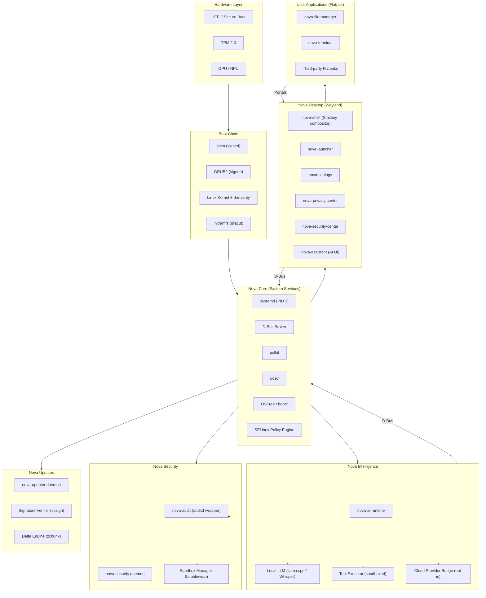
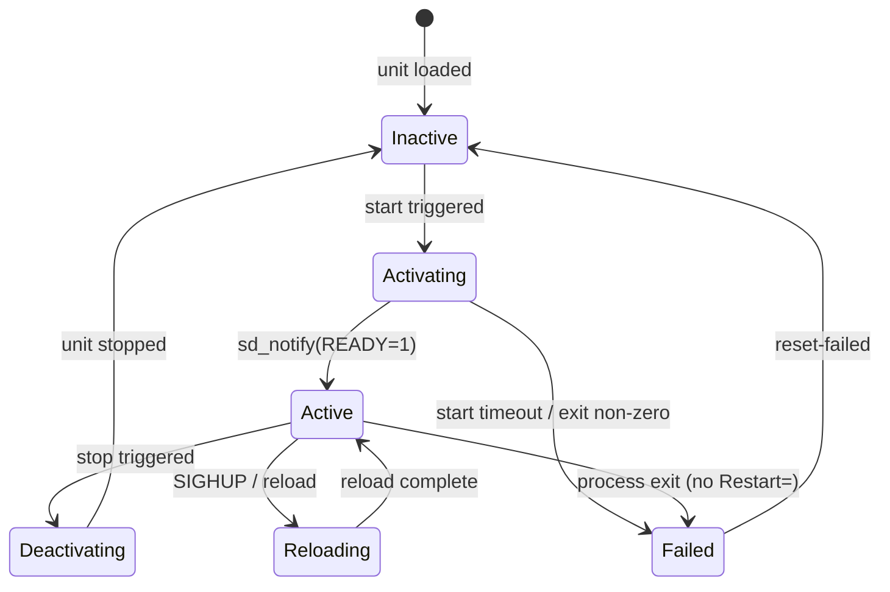
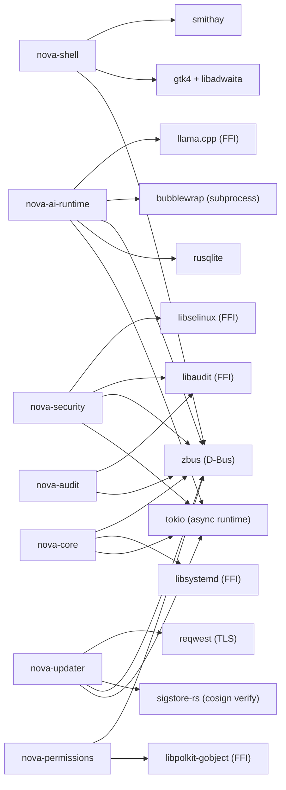
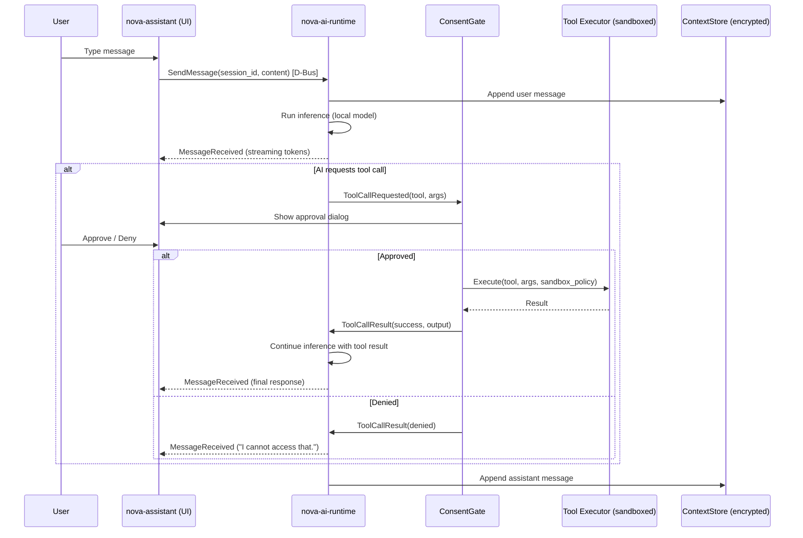

# NOVA OS — System Architecture

> Version: 0.1-dev | Last updated: 2026-11-24

## Table of Contents

1. [Vision & Design Philosophy](#1-vision--design-philosophy)
2. [High-Level Component Diagram](#2-high-level-component-diagram)
3. [Subsystem Reference](#3-subsystem-reference)
   - 3.1 Nova Core
   - 3.2 Nova Desktop
   - 3.3 Nova Intelligence (AI Runtime)
   - 3.4 Nova Security
   - 3.5 Nova Privacy
   - 3.6 Nova Accessibility
   - 3.7 Nova Updates
4. [Interface Contracts & D-Bus APIs](#4-interface-contracts--d-bus-apis)
5. [Service Lifecycle](#5-service-lifecycle)
6. [Dependency Graph](#6-dependency-graph)
7. [Technology Rationale](#7-technology-rationale)
8. [Data Flow Overview](#8-data-flow-overview)
9. [Future Considerations](#9-future-considerations)

---

## 1. Vision & Design Philosophy

NOVA OS is a privacy-first, AI-augmented Linux desktop operating system built on **Fedora Atomic** as its immutable base. The design is guided by four core principles:

| Principle | Meaning |
|-----------|---------|
| **Local-First** | All intelligence processing defaults to on-device models; network calls require explicit, per-session user consent |
| **Least Privilege** | Every service runs with the minimum capability set required for its task, enforced by SELinux and seccomp |
| **Atomic Integrity** | The OS image is read-only and verified at boot; updates are transactional and rollback-capable |
| **Transparent Agency** | AI actions are observable, explainable, logged, and reversible by the user |

NOVA OS is **not** a general-purpose Linux distribution. It is a curated, opinionated platform targeting privacy-conscious individuals, researchers, and organizations that require trustworthy AI tooling integrated at the OS level.

---

## 2. High-Level Component Diagram



---

## 3. Subsystem Reference

### 3.1 Nova Core

**Purpose:** Provides the foundational system services that all other subsystems depend upon.

**Crate:** `crates/nova-core`

**Key responsibilities:**
- systemd unit management and service supervision
- D-Bus broker configuration (dbus-broker, not legacy dbus-daemon)
- polkit rule loading and authorization dispatch
- OSTree repository management and boot environment tracking
- SELinux policy loading at boot (`/sys/fs/selinux`)
- Kernel parameter management (`/proc/sys`, `/sys`)
- Hardware event routing via udev rules

**Public API (D-Bus):**
```
Bus name:       org.nova.Core1
Object path:    /org/nova/Core1
Interface:      org.nova.Core1.Manager

Methods:
  GetVersion() → (major: u32, minor: u32, patch: u32, pre: String)
  GetBootID() → String
  GetMachineID() → String
  ListActiveServices() → Array<ServiceInfo>
  RequestReboot(reason: String) → ()         [polkit-guarded]
  RequestPowerOff(reason: String) → ()       [polkit-guarded]

Signals:
  ServiceStateChanged(name: String, old: String, new: String)
  LowMemoryWarning(available_kb: u64)
```

**Service units:**
- `nova-core.service` — always active, Type=notify
- `nova-audit.service` — started by nova-core, monitors audit log
- `nova-dbus-setup.service` — one-shot, sets up D-Bus policy before broker

---

### 3.2 Nova Desktop

**Purpose:** Provides the Wayland compositor, shell UI, and application runtime for the graphical environment.

**Crates:** `desktop/shell`, `desktop/launcher`, `desktop/settings`, `desktop/assistant`, `desktop/privacy-center`, `desktop/security-center`

**Component: nova-shell**

The Wayland compositor is built on **Smithay** (pure-Rust Wayland compositor library). It implements:
- `wl_compositor`, `wl_shm`, `wl_seat`, `wl_output` core protocols
- `xdg-shell` for application windows
- `layer-shell` (wlr-layer-shell) for panels, lockscreen, notifications
- `xdg-decoration` for server-side window decorations
- `pointer-constraints`, `relative-pointer` for gaming / precision input
- `input-method-v2` for IME integration
- `fractional-scale-v1` for HiDPI

The compositor runs as the **user session** (not root). GPU access is mediated via DRM/KMS with libseat for seat management.

**XDG Desktop Portals** are implemented for Flatpak application access:
- `org.freedesktop.portal.FileChooser`
- `org.freedesktop.portal.Screenshot`
- `org.freedesktop.portal.Settings` (dark mode, accent color)
- `org.freedesktop.portal.Notification`
- `org.freedesktop.portal.Camera`
- `org.freedesktop.portal.Location`
- `org.nova.portal.AIAssist` — NOVA-specific AI portal

**D-Bus API (nova-shell):**
```
Bus name:       org.nova.Shell1
Object path:    /org/nova/Shell1
Interface:      org.nova.Shell1.Compositor

Methods:
  GetOutputs() → Array<OutputInfo>
  TakeScreenshot(output: String) → (fd: UnixFd)  [polkit-guarded]
  SetWallpaper(path: String) → ()
  LockScreen() → ()
  GetFocusedApp() → AppInfo

Signals:
  AppFocusChanged(old: AppInfo, new: AppInfo)
  OutputHotplug(output: OutputInfo, connected: bool)
  IdleStateChanged(idle: bool)
```

---

### 3.3 Nova Intelligence (AI Runtime)

**Purpose:** Manages local and optional cloud AI model execution, tool call dispatch, context management, and AI session lifecycle.

**Crate:** `crates/nova-ai-runtime`

**Sub-components:**

| Component | Role |
|-----------|------|
| `ModelRegistry` | Maintains a catalog of available local models with capability descriptors |
| `SessionManager` | Creates and destroys isolated AI sessions; each session has its own context window |
| `ToolExecutor` | Sandboxed subprocess runner for AI-requested tool calls (file ops, shell, search) |
| `ConsentGate` | Intercepts every tool call and network request; prompts user for approval unless pre-authorized |
| `ProviderBridge` | Optional TLS-encrypted relay to cloud AI APIs (Gemini, OpenAI-compatible) |
| `ContextStore` | Encrypted SQLite database for conversation history (AES-256-GCM, key in user keyring) |

**Tool Execution Sandbox:**

Each AI-requested tool call runs inside a bubblewrap sandbox with:
- New mount namespace (read-only rootfs, only allowed paths bind-mounted)
- New network namespace (no network unless explicitly granted)
- New PID namespace
- Seccomp filter: allowlist of ~50 syscalls needed for the specific tool type
- SELinux domain: `nova_ai_tool_t` (enforced, no transition to other domains)
- CPU time limit: 30 seconds (configurable)
- Memory limit: 512 MB (configurable)
- No `setuid`, no capability acquisition

**D-Bus API:**
```
Bus name:       org.nova.AI1
Object path:    /org/nova/AI1
Interface:      org.nova.AI1.Runtime

Methods:
  CreateSession(model_id: String, config: SessionConfig) → session_id: String
  DestroySession(session_id: String) → ()
  SendMessage(session_id: String, content: String) → ()
  ListModels() → Array<ModelInfo>
  GetSessionInfo(session_id: String) → SessionInfo
  RevokeToolPermission(session_id: String, tool: String) → ()

Signals:
  MessageReceived(session_id: String, content: String, is_partial: bool)
  ToolCallRequested(session_id: String, tool: String, args: String)   ← UI must approve
  ToolCallResult(session_id: String, tool: String, success: bool)
  SessionExpired(session_id: String)
  ModelLoadProgress(model_id: String, percent: u8)
```

---

### 3.4 Nova Security

**Purpose:** Runtime security monitoring, SELinux policy enforcement, audit event collection, and sandbox management.

**Crates:** `crates/nova-security`, `crates/nova-audit`, `crates/nova-permissions`

**SELinux Policy Structure:**

```
os/policies/selinux/
├── nova.te          # Main type enforcement rules
├── nova_core.te     # Core service types
├── nova_ai.te       # AI runtime isolation policy
├── nova_desktop.te  # Compositor and shell policy
├── nova_app.te      # Flatpak application domain
├── nova.fc          # File contexts
├── nova.if          # Interface definitions
└── Makefile         # Policy compilation
```

Key domains:
- `nova_core_t` — core system service
- `nova_ai_runtime_t` — AI runtime process
- `nova_ai_tool_t` — individual tool execution (most restricted)
- `nova_compositor_t` — Wayland compositor
- `nova_app_t` — Flatpak user applications
- `nova_updater_t` — update daemon
- `nova_audit_t` — audit daemon

**D-Bus API (nova-security):**
```
Bus name:       org.nova.Security1
Object path:    /org/nova/Security1
Interface:      org.nova.Security1.Monitor

Methods:
  GetSecurityStatus() → SecurityStatus
  ListDenials(since: u64) → Array<AuditEvent>
  GetSELinuxMode() → String  ("enforcing"|"permissive"|"disabled")
  SetSELinuxMode(mode: String) → ()  [polkit-guarded, logged]
  GetSeccompProfiles() → Array<ProfileInfo>
  ScanApp(flatpak_app_id: String) → ScanResult

Signals:
  SELinuxDenial(context: String, target: String, class: String, permission: String)
  IntrusionAttempt(source: String, severity: u8)
  AuditEventBatch(events: Array<AuditEvent>)
```

---

### 3.5 Nova Privacy

**Purpose:** Data flow tracking, consent management, telemetry control, and privacy policy enforcement.

**Crates:** `crates/nova-ai-runtime` (ConsentGate), `desktop/privacy-center`

The Privacy subsystem is primarily policy and UI — it hooks into the AI Runtime's ConsentGate and the system's network namespace controls to enforce privacy decisions.

**Privacy Center (nova-privacy-center):** A GTK4/libadwaita application providing:
- Real-time display of active AI sessions and their data access
- Per-app permission dashboard (camera, microphone, location, contacts)
- Network traffic summary (which apps contacted which domains)
- Data deletion controls for each subsystem
- Telemetry opt-in/out toggle with granular controls

---

### 3.6 Nova Accessibility

**Purpose:** Ensures NOVA OS is fully usable by people with visual, motor, hearing, and cognitive differences.

**Integration points:**
- `AT-SPI2` accessibility bus is started as part of the user session
- nova-shell exports `org.a11y.atspi.Accessible` for shell components
- All desktop applications are built with GTK4 accessibility APIs enabled
- The compositor handles `AccessibilitySettings` from gsettings

See [`ACCESSIBILITY.md`](ACCESSIBILITY.md) for the full plan.

---

### 3.7 Nova Updates

**Purpose:** Manages atomic OS image updates, Flatpak application updates, and AI model updates.

**Crate:** `crates/nova-updater`

**Update channels:**
- `stable` — GPG-signed, cosign-verified OCI images; released on Fedora's cadence
- `beta` — Weekly builds; same signing requirements
- `edge` — Nightly CI builds; for contributors only

**Update process:**
1. `nova-updater` polls the update server (configurable interval, default 6 h)
2. Fetches update manifest (JSON, cosign-verified)
3. Downloads delta (zchunk) or full image layer
4. Verifies sha256 and cosign signature against pinned public key
5. Stages new deployment via `bootc switch` or `rpm-ostree rebase`
6. Presents notification to user; applies on next boot
7. On failed boot (systemd emergency mode), bootloader reverts to previous deployment

**D-Bus API:**
```
Bus name:       org.nova.Updater1
Object path:    /org/nova/Updater1
Interface:      org.nova.Updater1.Manager

Methods:
  CheckForUpdates() → UpdateInfo
  DownloadUpdate(version: String) → ()
  ApplyUpdate() → ()        [polkit-guarded]
  RollbackUpdate() → ()     [polkit-guarded]
  GetUpdateHistory() → Array<UpdateRecord>
  SetChannel(channel: String) → ()  [polkit-guarded]

Signals:
  UpdateAvailable(version: String, changelog: String, size_bytes: u64)
  DownloadProgress(percent: u8, bytes_downloaded: u64)
  UpdateApplied(version: String, requires_reboot: bool)
  UpdateFailed(version: String, error: String)
```

---

## 4. Interface Contracts & D-Bus APIs

### 4.1 D-Bus Naming Conventions

| Namespace | Subsystem |
|-----------|-----------|
| `org.nova.Core1` | Core system |
| `org.nova.Shell1` | Desktop compositor |
| `org.nova.AI1` | AI runtime |
| `org.nova.Security1` | Security monitor |
| `org.nova.Privacy1` | Privacy manager |
| `org.nova.Updater1` | Update manager |
| `org.nova.portal.*` | XDG Portal extensions |

All bus names follow `org.nova.<Subsystem><Version>` where version is a monotonically increasing integer (not semver) that increments only on breaking API changes.

### 4.2 Common Data Types

```
struct ServiceInfo {
    name: String,
    state: String,          // "active"|"inactive"|"failed"|"activating"
    sub_state: String,
    pid: u32,
    memory_bytes: u64,
    cpu_time_ns: u64,
    since: u64,             // Unix timestamp (seconds)
}

struct ModelInfo {
    id: String,             // e.g. "llama3.2-3b-q4"
    name: String,
    size_bytes: u64,
    quantization: String,   // "q4_k_m", "q8_0", "f16", etc.
    capabilities: Array<String>,  // ["chat","code","vision","embedding"]
    local: bool,
    loaded: bool,
}

struct AppInfo {
    app_id: String,         // Flatpak application ID
    name: String,
    pid: u32,
    wayland_surface_id: u32,
    selinux_context: String,
}

struct AuditEvent {
    seq: u64,
    timestamp: u64,
    event_type: String,
    subject_pid: u32,
    subject_context: String,
    object_path: String,
    object_context: String,
    result: String,         // "granted"|"denied"
    raw: String,
}
```

### 4.3 Authorization Model

All privileged D-Bus methods are gated by **polkit**. The policy file at `/usr/share/polkit-1/actions/org.nova.policy` defines:

```xml
<action id="org.nova.core.reboot">
  <defaults>
    <allow_any>no</allow_any>
    <allow_inactive>auth_admin</allow_inactive>
    <allow_active>yes</allow_active>
  </defaults>
</action>

<action id="org.nova.security.set-selinux-mode">
  <defaults>
    <allow_any>no</allow_any>
    <allow_inactive>no</allow_inactive>
    <allow_active>auth_admin_keep</allow_active>
  </defaults>
  <annotate key="org.freedesktop.policykit.imply">org.nova.core.modify-system</annotate>
</action>

<action id="org.nova.ai.execute-tool">
  <defaults>
    <allow_any>no</allow_any>
    <allow_inactive>no</allow_inactive>
    <allow_active>auth_self</allow_active>
  </defaults>
</action>
```

---

## 5. Service Lifecycle



**Restart policy:**

| Service | Restart policy | Restart delay |
|---------|---------------|---------------|
| nova-core | `on-failure` | 5 s |
| nova-ai-runtime | `on-failure` | 10 s |
| nova-shell | `on-failure` | 2 s |
| nova-security | `always` | 3 s |
| nova-updater | `on-failure` | 60 s |

**Dependency ordering:**

```
nova-security.service
  └─ Wants: nova-audit.service
  └─ Before: nova-core.service

nova-core.service
  └─ After: nova-security.service
  └─ Before: nova-shell.service, nova-ai-runtime.service, nova-updater.service

nova-shell.service (user session)
  └─ After: graphical.target, nova-core.service
  └─ BindsTo: graphical-session.target
```

---

## 6. Dependency Graph



---

## 7. Technology Rationale

### 7.1 Fedora Atomic (bootc / rpm-ostree)

**Choice:** Use Fedora Atomic as the OS base, managed via `bootc` (OCI-native image-based updates).

**Rationale:**
- **Immutable rootfs** via OSTree: `/usr` is read-only after boot; modifications require a new image deployment, eliminating configuration drift
- **Transactional updates**: Every update is atomic — either the entire new image is deployed or the old one remains; partial failures cannot corrupt the system
- **Rollback guarantee**: GRUB maintains the previous deployment; if the new boot fails, the previous generation is selected automatically
- **Fedora ecosystem**: Access to 70,000+ packages in the Fedora repository; strong SELinux integration; up-to-date kernel with hardware support
- **OCI compatibility**: `bootc` treats OS images as OCI container images, enabling CI/CD pipelines that use standard container tooling (Podman, Buildah, GitHub Actions)
- **Reproducibility**: Containerfile-based builds with pinned base image digests guarantee bit-for-bit reproducible OS images

**Alternatives considered:**
- NixOS: More reproducible but more complex; weaker AI hardware driver support; smaller contributor pool
- Arch Linux: Rolling release, not atomic, immature atomic overlays
- Ubuntu Core: Proprietary Snap ecosystem; weaker SELinux story

### 7.2 Wayland (Smithay)

**Choice:** Wayland-only display server with a custom Smithay-based compositor.

**Rationale:**
- **Security**: Wayland isolates application input/output by design — a client cannot read keystrokes or screenshots from other clients, unlike X11
- **Privacy**: No global screen capture without explicit portal permission
- **Rust integration**: Smithay is written in pure Rust, enabling memory-safe compositor code with no C unsafe surface for the shell
- **Modern protocol support**: native HiDPI, variable refresh rate, explicit synchronization (for Vulkan)
- **XWayland compatibility**: Legacy X11 applications are supported via XWayland, run in a separate SELinux domain

**Alternatives considered:**
- KWin (Wayland): Qt dependency; C++ codebase; harder to audit
- Mutter: GNOME dependency chain; not standalone composable
- weston: Reference implementation, not production-grade for custom UX

### 7.3 Rust

**Choice:** All NOVA OS system components (crates/) and desktop components are written in Rust.

**Rationale:**
- **Memory safety**: The compiler eliminates entire classes of vulnerabilities: buffer overflows, use-after-free, null pointer dereferences, data races — without a GC
- **Performance**: Zero-cost abstractions; comparable to C/C++ in benchmarks; suitable for a real-time compositor
- **Auditability**: Strong type system makes security invariants expressible at compile time; `unsafe` blocks are explicit and auditable
- **Ecosystem**: `zbus` for D-Bus, `smithay` for compositing, `tokio` for async I/O, `reqwest` for TLS HTTP, `rusqlite` for SQLite — all high-quality Rust libraries
- **Tooling**: `cargo`, `rustfmt`, `clippy`, `cargo-audit` provide integrated build, format, lint, and dependency vulnerability scanning

**Where C/C++ is used:**
- `llama.cpp` (AI inference, accessed via FFI with a thin safe wrapper)
- `libselinux`, `libaudit`, `libpolkit-gobject` (system libraries, accessed via FFI)
- GTK4 / libadwaita (accessed via `gtk4-rs` safe bindings)

### 7.4 Flatpak

**Choice:** All user applications are distributed and run as Flatpak packages.

**Rationale:**
- **Sandbox isolation**: Each Flatpak runs in a bubblewrap sandbox with its own mount namespace, isolated from the host rootfs
- **Permission model**: Portals mediate access to host resources (files, camera, microphone, location) with explicit user consent
- **Immutable base independence**: Applications carry their own runtimes, decoupled from the OS image
- **Signed distribution**: Flatpak repositories support GPG signing; NOVA uses a curated, signed repository
- **Update independence**: Application updates are independent of OS image updates

**Restrictions:** NOVA OS disables by default:
- `--filesystem=host` permission (access to full host filesystem)
- `--socket=session-bus` without portal mediation
- `--device=all` (must request specific device access via portal)

### 7.5 SELinux

**Choice:** SELinux in enforcing mode as the mandatory access control (MAC) system.

**Rationale:**
- **Mature**: 20+ years of production use in Fedora/RHEL; comprehensive policy tooling
- **Fedora integration**: Fedora's reference policy provides a solid foundation; NOVA OS adds a custom policy module on top
- **Kernel-enforced**: Decisions happen in the kernel before any userspace code runs; cannot be bypassed by a compromised application
- **Audit trail**: Every denial is logged to the kernel audit subsystem, feeding nova-audit
- **Principle of least privilege**: Each service type is defined with the minimum set of allowed operations; a compromised service cannot escalate beyond its type

**Alternatives considered:**
- AppArmor: Path-based rather than label-based; weaker guarantees; not the default on Fedora
- seccomp only: System call filtering is complementary, not a full MAC replacement

---

## 8. Data Flow Overview



---

## 9. Future Considerations

| Item | Status | Notes |
|------|--------|-------|
| Wayland virtual keyboard protocol | Planned v0.3 | IME for CJK languages |
| Vulkan WSI explicit sync | Planned v0.3 | Required for smooth gaming |
| Multi-seat support | Research | libseat supports it; UI work needed |
| Homomorphic encryption for cloud AI | Research | Performance not yet practical |
| Verified boot with TPM PCR sealing | v0.2 | PCR 7 for Secure Boot, PCR 11 for initrd |
| FIDO2 / passkey login | v0.2 | libfido2 integration with PAM |
| Sandboxed browser engine | v1.0 | Custom Servo-based mini-browser for portals |
