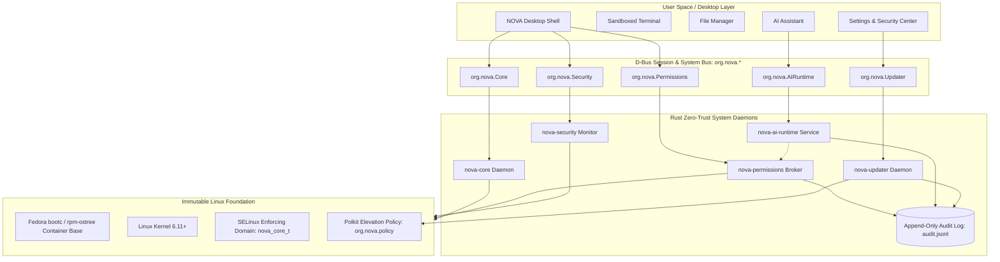

# NOVA OS — Mission 1: Engineering Team & Architecture Specification

## 1. Specialized Engineering Agents & Roles

| Agent | Title | Core Ownership & Scope | Key Artifacts |
| :--- | :--- | :--- | :--- |
| **AGENT 1** | **Systems Architect** | System topology, IPC protocol, subsystem boundaries, interface contracts | `docs/ARCHITECTURE.md`, `Cargo.toml`, `crates/nova-system-api` |
| **AGENT 2** | **OS Foundation Engineer** | Base OS image, bootloader, kernel params, systemd units, OSTree/bootc | `os/image/Containerfile`, `os/image/nova-os.ks`, `os/boot/*.service` |
| **AGENT 3** | **Rust Systems Engineer** | Low-level daemons, D-Bus bindings, hardware info, memory telemetry | `crates/nova-core`, `crates/nova-updater` |
| **AGENT 4** | **Desktop UI Engineer** | Wayland shell, window manager, top panel, dock, desktop canvas | `desktop/shell/src/components/*`, `desktop/shell/src/apps/*` |
| **AGENT 5** | **AI Runtime Engineer** | AI provider abstractions, tool registry, prompt confinement | `crates/nova-ai-runtime`, `desktop/shell/src/apps/nova-ai-assistant.ts` |
| **AGENT 6** | **Security Engineer** | Threat modeling, SELinux policies, polkit, device permission broker | `crates/nova-security`, `crates/nova-permissions`, `os/policies/*` |
| **AGENT 7** | **Accessibility Engineer** | AT-SPI2 integration, WCAG 2.2 AA compliance, keyboard navigation, focus | `docs/ACCESSIBILITY.md`, `desktop/shell/src/utils/keyboard.ts` |
| **AGENT 8** | **QA & Verification Engineer** | Unit tests, contract verification, mock fixtures, regression suite | `tests/integration/*`, `desktop/shell/src/tests/*` |
| **AGENT 9** | **Release & DevOps Engineer** | CI/CD automation, RPM packaging, update signing, release portal | `.github/workflows/*`, `packaging/*`, `website/*`, `scripts/*` |

---

## 2. Shared Architecture & Subsystem Boundaries



---

## 3. Strict Module Ownership & Directory Mapping

```
/nova-os
  ├── Cargo.toml                       # [Systems Architect] Workspace dependencies
  ├── docs/                            # [Systems Architect, Security, A11y, QA]
  │   ├── ARCHITECTURE.md              # [Systems Architect]
  │   ├── THREAT_MODEL.md              # [Security Engineer]
  │   ├── SECURITY.md                  # [Security Engineer]
  │   ├── PRIVACY.md                   # [Security Engineer]
  │   ├── ACCESSIBILITY.md             # [Accessibility Engineer]
  │   ├── BUILD.md                     # [Release Engineer]
  │   ├── ROADMAP.md                   # [Systems Architect]
  │   └── TESTING.md                   # [QA Engineer]
  ├── os/                              # [OS Foundation Engineer]
  │   ├── image/                       # Containerfile, Kickstart, Boot configs
  │   ├── boot/                        # Systemd unit definitions
  │   ├── policies/                    # SELinux (.te) and Polkit (.policy)
  │   └── updates/                     # Update manifest schemas
  ├── crates/                          # [Rust Systems, Security, AI Engineers]
  │   ├── nova-system-api/             # [Systems Architect] Shared types and D-Bus traits
  │   ├── nova-core/                   # [Rust Systems] Telemetry & resource monitoring
  │   ├── nova-security/               # [Security Engineer] Real hardware posture checks
  │   ├── nova-permissions/            # [Security Engineer] Broker & persistent store
  │   ├── nova-ai-runtime/             # [AI Runtime Engineer] Tool allowlist & providers
  │   ├── nova-audit/                  # [Security Engineer] Append-only audit logger
  │   └── nova-updater/                # [Release Engineer] bootc update coordination
  ├── desktop/shell/                   # [Desktop UI Engineer]
  │   ├── src/components/              # TopBar, Dock, Launcher, Window, QuickSettings
  │   ├── src/apps/                    # Terminal, Files, Settings, Security, AI
  │   ├── src/state/                   # Reactive state store
  │   └── src/services/                # Client D-Bus API bridge
  ├── packaging/                       # [Release Engineer] RPM spec, Flatpak manifests
  ├── tests/                           # [QA Engineer]
  │   ├── integration/                 # Cross-daemon API contract tests (82 tests)
  │   └── fixtures/                    # Mock JSON fixtures
  └── website/                         # [Release Engineer] Landing page & interactive demo
```

---

## 4. API Contracts

### D-Bus Interface Specifications:

1. **`org.nova.Core`** (`/org/nova/Core`)
   - `GetSystemInfo() -> (String json)`
     - Schema: `{"hostname": str, "kernel_version": str, "os_version": str, "uptime_seconds": u64, "cpu_model": str, "total_memory_bytes": u64}`
   - `GetResourceUsage() -> (String json)`
     - Schema: `{"cpu_percent": f64, "memory_used_bytes": u64, "memory_total_bytes": u64, "load_average_1m": f64}`
   - `GetServiceStatus(name: String) -> (String json)`

2. **`org.nova.Permissions`** (`/org/nova/Permissions`)
   - `RequestPermission(app_id: String, permission: String, reason: String) -> (String json)`
   - `GrantPermission(app_id: String, permission: String) -> (bool success)`
   - `RevokePermission(app_id: String, permission: String) -> (bool success)`
   - `GetAppPermissions(app_id: String) -> (String json)`

3. **`org.nova.AIRuntime`** (`/org/nova/AIRuntime`)
   - `ProcessQuery(query: String, context: String) -> (String text)`
   - `ExecuteTool(tool_name: String, params_json: String) -> (String json)`
     - Mandatory rule: checks `org.nova.Permissions` allowlist before invoking handler.

4. **`org.nova.Security`** (`/org/nova/Security`)
   - `GetSecurityStatus() -> (String json)`
     - Schema: `{"secure_boot_enabled": Option<bool>, "selinux_mode": str, "dm_crypt_active": Option<bool>, "firewall_active": Option<bool>}`
     - Strict rule: never fabricate status values; returns null or "Unknown" when unverifiable.

---

## 5. Git Branching & Coordination Strategy

1. **Main Trunk (`main`)**: Always deployable, passing all CI checks, signed releases tagged as `v*.*.*`.
2. **Feature Branches**:
   - `feat/os-bootc-*`: OS container builds and kickstarts.
   - `feat/rust-core-*`: System services and D-Bus APIs.
   - `feat/desktop-ui-*`: Desktop shell components and themes.
   - `feat/ai-runtime-*`: AI provider integrations and tool sandboxing.
   - `feat/sec-policies-*`: SELinux rules and polkit elevation.
3. **Merging Rules**:
   - Every PR requires `cargo fmt`, `cargo clippy`, `vitest` pass, and `python -m unittest` 100% passing.
   - No direct commits to `main` without automated CI validation.

---

## 6. Dependency Boundaries & Least Privilege

1. **Rust Crates**:
   - `nova-system-api` has zero internal crate dependencies (pure types and D-Bus interfaces).
   - `nova-core`, `nova-security`, and `nova-updater` depend only on `nova-system-api` and optional `nova-audit`.
   - `nova-ai-runtime` NEVER executes arbitrary shell strings; tools must be compiled into `ToolRegistry`.
2. **Desktop Shell**:
   - Communicates exclusively via typed API bridges (`nova-api.ts`).
   - Runs in client sandbox without direct root or system file system write access.

---

## 7. Integration Test Strategy

- **Layer 1: Unit Tests**: High-speed, in-memory validation of data structures, JSON schemas, and broker state.
- **Layer 2: Contract Tests (`tests/integration/`)**: 82 automated Python test cases asserting exact JSON shapes, type boundaries, and security invariants.
- **Layer 3: UI Component Tests (`desktop/shell/src/tests/`)**: Automated Vitest test runner validating desktop state transitions, window focus, and keyboard shortcuts.
- **Layer 4: End-to-End Vertical Slice**: Live web desktop connected to API services, demonstrating launching apps, viewing real system stats, inspecting security posture, and issuing AI commands with permission checks.
