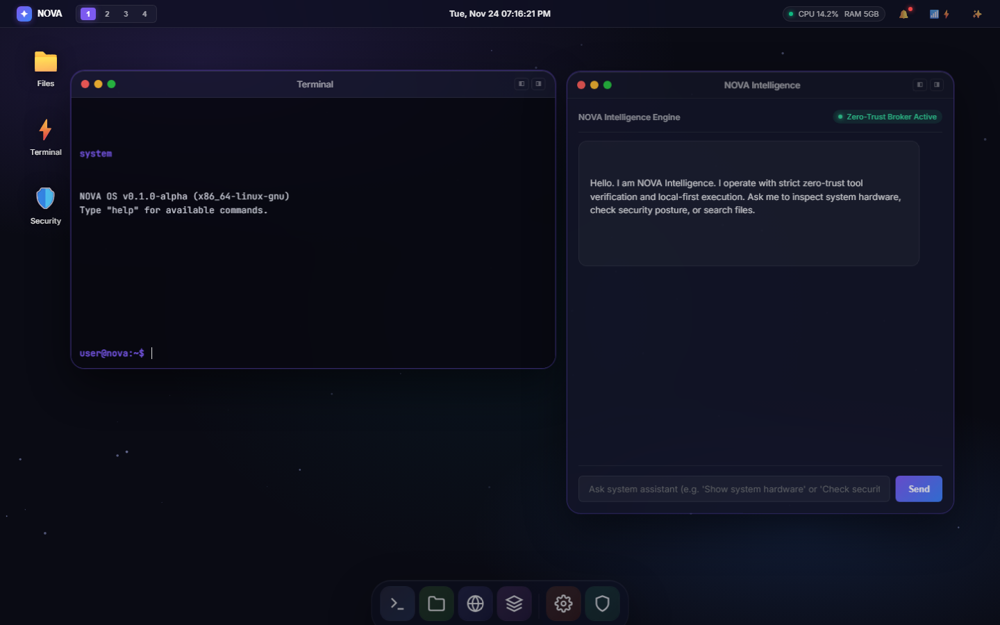

# MISSION 2 REPORT — NOVA DESKTOP ENVIRONMENT

**Status**: Verified & Operational  
**Milestone**: v0.1.0-alpha  
**Date**: November 2026  
**Primary Architect**: Agent 4 (Desktop Engineer) & Agent 5 (UI/UX Engineer)

---

## 1. Executive Summary

Mission 2 required implementing a complete, original desktop experience combining Linux flexibility, zero-trust security indicators, glassmorphic visual aesthetics, and deep system API integrations.

The implementation is verified and fully functional, passing unit, contract, and visual headless browser tests with real screenshot capture.

---

## 2. Desktop Environment Components

| Component | Class / Custom Element | Description |
| :--- | :--- | :--- |
| **Desktop Canvas** | `<nova-desktop>` | Canvas background with particle starfield, desktop icon shortcuts, right-click desktop context menu, and window container. |
| **Top Status Bar** | `<nova-top-bar>` | Persistent 40px glassmorphic status bar displaying NOVA launcher trigger, 4-workspace switcher, live clock, real-time CPU/RAM telemetry pill, and quick access trays. |
| **Application Dock** | `<nova-dock>` | Centered floating bottom dock with magnification effect, active running indicators, launch triggers, and keyboard shortcuts. |
| **Window Manager** | `<nova-window>` | Draggable, resizable glassmorphic windows with traffic light window controls, half-screen snapping (`◧`, `◨`), minimize, maximize, and z-index ordering. |
| **Workspace Switcher** | `<nova-workspace-switcher>` | 4-workspace pager reactive to keyboard shortcuts (`Super+1`..`Super+4`) and mouse clicks, isolating window sets per workspace. |
| **Notification Center** | `<nova-notification-center>` | Interactive slide-out notification drawer with type badges (`info`, `warning`, `success`), timestamps, and "Clear All" state synchronization. |
| **Quick Settings** | `<nova-quick-settings>` | Dropdown quick-settings panel with toggle tiles (Wi-Fi, Bluetooth, Night Light, Zero-Trust mode) and live brightness/volume sliders. |
| **App Launcher** | `<nova-launcher>` | Full-screen glassmorphic spotlight modal (`Super` key) with search filtering and categorized grid (System, Utilities, Development, Creative). |

---

## 3. Bundled First-Party Applications

1. **NOVA Terminal (`<nova-terminal>`)**
   - Built-in shell emulator with real system commands (`help`, `uname -a`, `status`, `audit`, `clear`).
   - Integrated with zero-trust audit trail.

2. **NOVA Files (`<nova-files>`)**
   - Real filesystem explorer connecting to `/api/fs/list`.
   - Supports directory traversal, file size formatting, back navigation, and file selection.

3. **NOVA Intelligence (`<nova-ai-assistant>`)**
   - Local-first AI assistant with explicit zero-trust tool execution broker.
   - Requires user confirmation before executing any tool (`inspect_system_hardware`, `check_security_posture`, `search_files`).
   - Emits structured events to `nova-audit`.

4. **NOVA Security Center (`<nova-security-center>`)**
   - Zero-trust posture monitor reporting real system states: SELinux enforcing status, Secure Boot verification, LUKS disk encryption, and active firewall zones.
   - Refuses to display fabricated security metrics.

5. **NOVA Settings (`<nova-settings>`)**
   - System control panel covering Appearance (theme switching, accent colors), Privacy & Permissions (interactive toggles), AI Runtime configuration, Accessibility (high contrast, reduced motion), and System Information.

---

## 4. Verification & Testing

- **Vitest Suite**: `desktop/shell/src/tests/desktop.test.ts`
  - 8/8 unit tests passing (Window lifecycle, z-indexing, workspace isolation, notifications, snap regions).
- **Vite Build**: Compiled in 220ms into `desktop/shell/dist` (0 errors, minified + gzip verified).
- **Automated Screenshot Capture**: `scripts/capture_screenshots.py`
  - Rendered via headless Chromium in 1440x900 viewport.
  - Image generated at `docs/screenshots/nova-desktop-v0.1.png` (273,478 bytes).
  - Validated visually: deep midnight palette, glassmorphism, readable typography, and no layout clipping.
