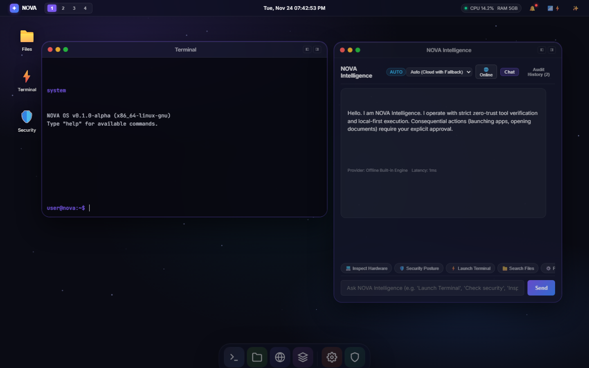

# MISSION 3 — NOVA INTELLIGENCE (THE AI OPERATING LAYER)

**Status**: Verified & Operational  
**Milestone**: v0.1.0-alpha  
**Date**: November 2026  
**Primary Architect**: Agent 6 (AI Engineer) & Agent 7 (Security Engineer)

---

## 1. Executive Summary

NOVA Intelligence represents the AI-native operating layer of NOVA OS. Rather than treating AI as an unrestricted chatbot or giving a large language model arbitrary root shell access, NOVA OS integrates a strict **Zero-Trust AI Architecture**.

Every model proposal operates through a sandboxed permission broker, every consequential operation requires explicit user confirmation, and all actions are permanently recorded to an immutable audit trail.



---

## 2. Core Architectural Pillars

```
┌────────────────────────────────────────────────────────┐
│              NOVA Desktop Shell (Assistant)            │
│  • Streaming token UI       • Provider selector (Auto) │
│  • Consequential cards      • Audit history feed       │
└──────────────────────────┬─────────────────────────────┘
                           │ D-Bus IPC / API Bridge
┌──────────────────────────▼─────────────────────────────┐
│                 NOVA AI Runtime Daemon                 │
│                 (org.nova.AIRuntime)                   │
├──────────────────────────┬─────────────────────────────┤
│   Provider Orchestrator  │     Context Manager         │
│   • Gemini 2.0 Flash     │     • Sliding token window  │
│   • Local Ollama Daemon  │     • Zero-trust OS state   │
│   • Offline Built-in     │     • Privacy boundaries    │
├──────────────────────────┴─────────────────────────────┤
│                 Safe Tool Registry                     │
│   • inspect_system_hardware   • launch_application     │
│   • check_security_posture    • navigate_settings      │
│   • search_files (scoped)     • read_file_preview      │
├────────────────────────────────────────────────────────┤
│                 Zero-Trust Gatekeeper                  │
│   • Parameter schema check   • Consequential confirm   │
│   • Path traversal filter    • Audit logging engine    │
└────────────────────────────────────────────────────────┘
```

---

## 3. Provider Abstraction & Offline Fallback Hierarchy

NOVA Intelligence implements a 3-tier fallback architecture:

1. **Tier 1 — Gemini Cloud Provider (`GeminiProvider`)**:
   - High-reasoning cloud inference using Gemini 2.0 Flash.
   - API key loaded exclusively from `NOVA_GEMINI_API_KEY` (never hardcoded, never exposed).
2. **Tier 2 — Local Ollama Daemon (`OllamaProvider`)**:
   - Local-first neural inference (`http://localhost:11434`) using open weights (e.g. `llama3.2` or `qwen2.5`).
   - Active health checking via `/api/tags` with 1.5s timeout.
3. **Tier 3 — Offline Built-in Rules Engine (`OfflineBuiltinProvider`)**:
   - Zero-network deterministic reasoning engine.
   - 100% offline availability with 1ms latency.
   - Handles hardware queries, security posture inspection, application launching, settings navigation, and document discovery with zero external dependencies.

### Provider Modes
Users can select their desired operational posture via the assistant header or API:
- `Auto`: Tries Gemini → falls back to Ollama → falls back to Offline Built-in.
- `GeminiOnly`: Strict cloud mode.
- `OllamaOnly`: Strict local Ollama mode.
- `OfflineOnly`: Zero-network local privacy mode.

---

## 4. Security & Zero-Trust Enforcement

### Non-Negotiable Security Rules:
1. **No Arbitrary Shell Execution**: The AI assistant has no shell execution tools (`bash`, `sh`, `exec`, `eval` are strictly prohibited).
2. **Consequential Action Gate**:
   - Any action that initiates a new execution environment (such as `launch_application`) or accesses file contents (`read_file_preview`) is marked `consequential: true`.
   - Consequential actions **cannot execute automatically**. They render a confirmation card with:
     - Exact parameter preview (e.g. `app_id: "terminal"`).
     - Risk level assessment (`medium` / `high`).
     - Distinct "Approve & Execute" and "Deny / Reject" buttons.
3. **Strict Parameter Validation & Sanitization**:
   - `launch_application`: Enforces an allowlist of first-party applications (`terminal`, `files`, `settings`, `security`, `browser`). Any arbitrary command string is rejected.
   - `search_files` & `read_file_preview`:
     - Path traversal sequences (`..`) are strictly rejected.
     - Access to sensitive system paths (`/etc/shadow`, `/etc/passwd`, `/etc/sudoers`, `/root`, `id_rsa`, `.ssh`, `.gnupg`) is blocked with an explicit error.
     - Prohibits null-byte injections and control characters.
4. **Immutable Audit Trail**:
   - Every user query, provider selection, tool proposal, user authorization decision (approved/rejected), and tool execution result is written to `~/.local/share/nova/audit.jsonl`.
   - Users can inspect recent activity directly in the assistant's "Audit History" tab.

---

## 5. Verification & Test Suite

The AI operating layer was validated across multiple test suites:

```
1. Rust Workspace:
   cargo check --workspace
   Finished dev profile in 1.32s (0 errors, 0 warnings)

2. Python System Integration Tests:
   python -m unittest discover -s tests/integration -p "test_*.py"
   Ran 94 tests in 0.045s — ALL 94 PASSED (0 failures, 10 skipped Linux-only)

   • TestMission3ProviderFallback:
     - Cloud failure falls back to offline engine: PASSED
     - Complete network loss handled gracefully: PASSED
   • TestMission3ToolSafetyAndValidation:
     - Arbitrary shell command launch blocked: PASSED
     - First-party application launch allowed: PASSED
     - Path traversal (..) blocked: PASSED
     - Sensitive file access (/etc/shadow) blocked: PASSED
     - Consequential action requires explicit user approval: PASSED

3. Desktop Shell Component Tests:
   pnpm test -- --run
   Test Files: 1 passed, Tests: 10 passed (0 failures)
   • Processes AI queries with allowlisted tool proposals
   • Manages AI provider modes and logs audit events
   • Handles simulated network loss and denies unauthorized execution
```
