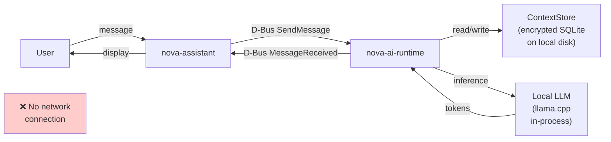
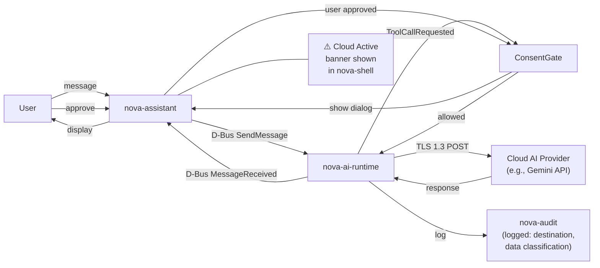

# NOVA OS — Privacy Architecture

> Version: 0.1-dev | Last updated: 2026-11-24  
> References: ARCHITECTURE.md, THREAT_MODEL.md, GDPR (Regulation EU 2016/679)

## Table of Contents

1. [Privacy Philosophy](#1-privacy-philosophy)
2. [Data Minimization](#2-data-minimization)
3. [Local-First Design](#3-local-first-design)
4. [AI Data Handling](#4-ai-data-handling)
5. [Telemetry Architecture](#5-telemetry-architecture)
6. [GDPR & Regulatory Alignment](#6-gdpr--regulatory-alignment)
7. [Data Deletion Guarantees](#7-data-deletion-guarantees)
8. [Privacy Center (UI)](#8-privacy-center-ui)
9. [Data Flow Maps](#9-data-flow-maps)
10. [Privacy Review Process](#10-privacy-review-process)

---

## 1. Privacy Philosophy

NOVA OS treats privacy as a **default state**, not a setting the user must discover and enable. The design goal is that a user who never touches privacy settings should still have the strongest available privacy protections.

### Core Commitments

| Commitment | Meaning in practice |
|-----------|-------------------|
| **Local-first** | AI inference runs on-device by default; no cloud AI without explicit session-level opt-in |
| **Data minimization** | Collect only what is strictly necessary for the specific function; delete immediately when no longer needed |
| **Purpose limitation** | Data collected for one purpose (e.g., AI context) is never repurposed (e.g., for telemetry) |
| **Consent-first** | Any data leaving the device requires affirmative user consent at the moment it would leave, not buried in a ToS |
| **Transparency** | Users can see exactly what data each subsystem holds about them, in human-readable form, at any time |
| **Erasability** | Every piece of NOVA OS-managed user data can be deleted by the user, completely and verifiably |

### What NOVA OS Does NOT Do

- Send conversation history to any server without explicit per-session consent
- Build a user profile or behavioral model for advertising
- Share data between subsystems without documented justification
- Use crash reports to identify individual users
- Store raw audio/video without explicit recording consent
- Retain telemetry after the user opts out

---

## 2. Data Minimization

### 2.1 Principle

For each piece of data that NOVA OS could collect, we ask:

1. **Is this data necessary?** If a feature can be implemented without collecting this data, we do not collect it.
2. **Is this the minimum needed?** If we need location, we use coarse city-level, not GPS coordinates.
3. **For how long?** We set an explicit retention period and enforce deletion at the end of it.

### 2.2 Data Inventory

| Data Type | Collected By | Retention | Leaves Device? | Justification |
|-----------|-------------|-----------|----------------|--------------|
| AI conversation history | nova-ai-runtime | Until session ends (default) or user-set period | No (unless cloud AI enabled) | Required for AI context |
| AI model weights | nova-ai-runtime | Until user deletes model | No | Required for local inference |
| System logs (journald) | systemd | 30 days (rotating) | No | System diagnostics |
| Audit logs | nova-audit | 90 days (rotating) | No (unless SIEM configured) | Security compliance |
| Update check timestamp | nova-updater | Last check only | Yes (to update server) | Required for update availability |
| Installed Flatpak list | Flatpak | Current state only | No | Local dependency management |
| Crash reports | nova-core | Until reported | No (unless crash reporting opt-in) | Stability improvement |
| Anonymous feature metrics | nova-telemetry | Aggregated, no PII | Yes (opt-in only) | Product improvement |
| Input device events | nova-shell | Never persisted | No | Real-time input handling |
| Clipboard contents | nova-shell | Until overwritten | No | Clipboard functionality |
| Screen contents | nova-shell | Never persisted | No (screenshots require consent) | Display functionality |

### 2.3 Minimum Data Technical Enforcement

```rust
// crates/nova-ai-runtime/src/context_store.rs
// Context is stored only in an encrypted, session-scoped SQLite database

pub struct ContextStore {
    db: SqliteConnection,
    session_id: Uuid,
    key: AesGcmKey,            // Per-session key, never persisted to disk
    max_retention: Duration,   // User-configured; default: session lifetime
}

impl Drop for ContextStore {
    fn drop(&mut self) {
        // Automatic deletion: when the session ends, the encrypted DB rows
        // are overwritten with zeros before the key is dropped from memory
        self.secure_delete_session_data(self.session_id);
    }
}
```

---

## 3. Local-First Design

### 3.1 Architecture

NOVA OS's AI runtime is architected so that **all AI inference is local by default**:

```
Default state:
  User message → nova-ai-runtime → Local model (llama.cpp) → Response
  
  No network connection is made.
  No data leaves the device.

Opt-in cloud state (requires explicit session configuration):
  User message → nova-ai-runtime → ConsentGate
                                      ↓ [shows "this will be sent to Provider X"]
                                   User approves
                                      ↓
                                   ProviderBridge → Cloud API (TLS 1.3)
                                      ↓
                                   Response
```

### 3.2 Local Models

NOVA OS ships with a selection of local AI models in the base OS image or as optional Flatpak extensions:

| Model | Size | Use case | Quantization |
|-------|------|---------|--------------|
| Llama 3.2 3B | ~2 GB | Chat, Q&A | Q4_K_M |
| Llama 3.2 1B | ~800 MB | Low-memory devices | Q4_K_M |
| Whisper.cpp Small | ~240 MB | Speech-to-text | F16 |
| Nomic Embed Text | ~270 MB | Semantic search, RAG | F16 |
| Phi-3.5 Mini | ~2.3 GB | Code, reasoning | Q4_K_M |

Additional models can be downloaded from the NOVA model registry (models are signed and verified before loading).

### 3.3 Network Request Transparency

For the rare cases where the user enables cloud AI or update checks, all outgoing network requests are:
1. Logged to nova-audit with the destination and data classification
2. Visible in the Privacy Center's Network Activity view in real-time
3. Blocked if the user has set a "No Network" mode in Privacy Center

### 3.4 Air-Gap Mode

For users requiring full network isolation, NOVA OS supports an "Air-Gap Mode" that:
- Sets `nova_ai_cloud_enabled=off` (SELinux boolean)
- Blocks all nova system service outbound connections via nftables
- Disables the update checker (user must update manually via signed USB image)
- Disables crash reporting submission even if previously enabled

---

## 4. AI Data Handling

### 4.1 What Stays Local

| Data | Local? | Notes |
|------|--------|-------|
| All conversation messages | Always | Stored in encrypted ContextStore |
| Documents/files fed to AI | Always | Never copied out of tool sandbox |
| Screen content fed to AI (future) | Always | Processed in-memory, not stored |
| Voice input (Whisper) | Always | Audio never stored; transcript is local |
| AI model weights | Always | Never uploaded |

### 4.2 What May Leave the Device (Opt-In Only)

| Data | Condition | Destination | User Control |
|------|-----------|------------|--------------|
| Conversation messages | Cloud AI session enabled, per-message | Cloud AI provider | Per-session toggle; shown in ConsentGate |
| Anonymous crash data | Crash reporting opt-in | NOVA telemetry server | Opt-in checkbox on first boot |
| Anonymous feature usage counts | Telemetry opt-in | NOVA telemetry server | Opt-in; can disable in Privacy Center |
| Anonymous hardware info (for update compatibility) | Telemetry opt-in | NOVA telemetry server | Opt-in |

### 4.3 ConsentGate: Per-Request Consent

The ConsentGate is the enforcement point for every network request the AI runtime would make:

```rust
// crates/nova-ai-runtime/src/consent.rs

pub struct ConsentGate {
    ui_sender: mpsc::Sender<ConsentRequest>,
    session_permissions: Arc<RwLock<SessionPermissions>>,
}

pub struct ConsentRequest {
    pub request_id: Uuid,
    pub session_id: Uuid,
    pub action: ConsentAction,
    pub description: String,  // Human-readable; shown in dialog
    pub data_preview: String,  // What data would be sent; truncated to 500 chars
    pub destination: String,  // e.g., "api.openai.com"
    pub responder: oneshot::Sender<ConsentDecision>,
}

pub enum ConsentAction {
    SendToCloudAI { provider: String, model: String, message_preview: String },
    ExecuteFileTool { path: PathBuf, operation: FileOperation },
    ExecuteNetworkTool { url: String, method: String },
    ExecuteShellCommand { command: String },
}

pub enum ConsentDecision {
    Allow,
    AllowAlways,  // For this session, pre-approve this action type
    Deny,
    DenyAlways,   // For this session, block this action type
}
```

The ConsentGate dialog shown to the user displays:
- **What the AI wants to do** (plain English)
- **What data would be involved** (file path, URL, command)
- **Where data would go** (network destination, if any)
- **Why the AI says it needs this** (AI-provided justification, clearly labeled as such)
- Options: Allow once | Allow for this session | Deny once | Deny for this session

### 4.4 Cloud AI Session Disclosure

When the user enables cloud AI for a session, they see a persistent indicator:

```
┌─────────────────────────────────────────────────────────┐
│ ⚠  Cloud AI Active                                      │
│ Messages are being sent to: Gemini (Google)             │
│ Subject to Google's privacy policy                      │
│ [Switch to Local]  [Privacy Policy]  [Session Details]  │
└─────────────────────────────────────────────────────────┘
```

This banner is rendered by nova-shell's layer-shell overlay and cannot be obscured by application windows.

---

## 5. Telemetry Architecture

### 5.1 Opt-In Design

Telemetry is **off by default**. The first-boot setup wizard presents a clear, non-deceptive choice:

```
Help improve NOVA OS?

You can help the NOVA OS team understand how the system is used by sharing
anonymous usage statistics. This data:

  ✓ Does not include your name, email, or account information
  ✓ Does not include your files, conversations, or AI prompts
  ✓ Does not include precise location
  ✓ Can be turned off at any time in Privacy Center

What would be shared:
  • Which hardware components are in use (CPU family, GPU vendor, RAM amount)
  • How often core features are used (counts, not content)
  • Crash reports without personal data
  • OS version and update channel

  ○ Yes, share anonymous statistics
  ● No, don't share statistics     ← Default

                                        [Continue]
```

### 5.2 Telemetry Data Schema

If opted in, the telemetry payload is:

```json
{
  "schema_version": 1,
  "nova_version": "0.1.0",
  "channel": "stable",
  "session_id": "random-per-payload-uuid",   // Not tied to machine or user
  "hw": {
    "cpu_arch": "x86_64",
    "cpu_vendor": "amd",                     // "intel", "amd", "arm"
    "cpu_core_count": 8,
    "ram_gb_bucket": "16-32",               // Bucketed, not exact
    "gpu_vendor": "nvidia",
    "has_npu": false,
    "display_count": 1
  },
  "features": {
    "ai_local_session_count_7d": 12,        // Counts, never content
    "ai_cloud_session_count_7d": 0,
    "flatpak_app_launch_count_7d": 45,
    "compositor_crash_count_7d": 0,
    "update_applied_this_week": true
  },
  "crash_hashes": ["sha256-of-stack-trace"] // No userdata in stack trace
}
```

**What is NEVER included:**
- Username, UID, or any user identifier
- File paths, filenames, or file contents
- AI conversation content, even hashed
- Installed app names (only count)
- Network requests made by apps
- Clipboard contents
- Exact hardware serial numbers

### 5.3 Telemetry Transport

- **Endpoint:** `https://telemetry.nova-os.example/v1/report`
- **TLS 1.3** with certificate pinning
- **No authentication:** Server receives data without any user identifier
- **Payload size limit:** 4 KB; payload is rejected if larger
- **Frequency:** Once per week maximum; randomized ±24 hours to prevent correlation
- **Opt-out enforcement:** `nova_telemetry_enabled=off` SELinux boolean blocks outbound connections from nova-telemetry service

---

## 6. GDPR & Regulatory Alignment

### 6.1 Applicability

NOVA OS is a software product distributed to users who may be EU residents. Under GDPR, NOVA OS acts as a **data processor** when processing user data on-device, and potentially as a **data controller** when receiving telemetry.

### 6.2 Lawful Bases

| Processing activity | Lawful basis | Notes |
|--------------------|-------------|-------|
| Local AI processing of user messages | Contract (providing the requested service) | No consent needed; processing stays local |
| Anonymous telemetry | Consent (Art. 6(1)(a)) | Explicit opt-in required; freely revocable |
| System logs for stability | Legitimate interests (Art. 6(1)(f)) | Necessary for secure operation; local only |
| Crash reporting | Consent | Explicit opt-in; crash data is anonymized |

### 6.3 Data Subject Rights

| Right | How NOVA OS implements it |
|-------|--------------------------|
| **Right of access (Art. 15)** | Privacy Center → "Export my data" shows all stored data in JSON format |
| **Right to erasure (Art. 17)** | Privacy Center → "Delete all data" triggers verifiable deletion; see §7 |
| **Right to data portability (Art. 20)** | AI conversation export as standard JSON; settings export as TOML |
| **Right to restrict processing (Art. 18)** | Telemetry opt-out in Privacy Center; AI cloud toggle per session |
| **Right to object (Art. 21)** | Telemetry is opt-in; objection is the default state |
| **Rights related to automated decision-making (Art. 22)** | NOVA OS AI does not make legally significant automated decisions |

### 6.4 Privacy by Design (Art. 25)

GDPR Art. 25 requires privacy by design and by default. NOVA OS demonstrates compliance:
- **By design:** ConsentGate, local-first architecture, encryption at rest are core architectural features
- **By default:** Telemetry off, cloud AI off, crash reporting off — all off until user enables them
- **Data minimization:** Automated retention limits and deletion (§2, §7)

### 6.5 CCPA / Other Regulations

| Regulation | Jurisdiction | NOVA OS Status |
|-----------|-------------|---------------|
| GDPR | EU/EEA | Aligned (§6.1–6.4) |
| CCPA | California, USA | Aligned (opt-out is the default for data sale; NOVA does not sell data) |
| PIPEDA | Canada | Aligned (consent-based, purpose limitation) |
| LGPD | Brazil | Aligned (similar to GDPR; consent-first) |
| UK GDPR | UK | Aligned (identical requirements to EU GDPR) |

---

## 7. Data Deletion Guarantees

### 7.1 Deletion Types

| Type | Method | Guarantee |
|------|--------|-----------|
| **Logical deletion** | SQLite `DELETE` + vacuum | Data removed from application-visible storage |
| **Secure deletion** | Overwrite with zeros before deallocation | Data not recoverable without forensic media analysis |
| **Encrypted deletion** | Drop the encryption key | Data on disk is permanently unintelligible without the key |

NOVA OS uses **encrypted deletion** as the primary method for sensitive AI data: the AES-256-GCM key for the ContextStore is derived per-session and dropped at session end (or on explicit deletion), making all encrypted data unintelligible.

### 7.2 Deletion Scope by Component

#### AI Conversation History

```
User action: Privacy Center → "Delete AI History" → [Session / All Time]

What is deleted:
  - All ContextStore rows for the specified scope
  - The session-specific encryption key (dropped from kernel keyring)
  - Temporary files in /tmp/nova-ai-* for the session

What is NOT deleted:
  - Audit log entries (security records; cannot be deleted by user)
  - System journal entries related to AI service start/stop

Deletion method: Encrypted deletion (key destruction) + SQLite VACUUM
Time to complete: < 5 seconds for a single session; < 30 seconds for all history
Verification: Privacy Center shows "History deleted" with a verifiable hash
```

#### Telemetry Data

```
User action: Privacy Center → Telemetry → "Delete all telemetry data I sent"

What is deleted:
  - Local telemetry queue (not yet sent)
  - Request sent to telemetry server to delete all data for this device's
    public key (the server stores no user identifier; deletion is best-effort)

What is NOT deleted:
  - Aggregated anonymous statistics that have already been aggregated
    (by definition not attributable to the user)

Time to complete: Local deletion immediate; server-side: 30 days (documented)
```

#### System Logs

```
User action: Privacy Center → "Clear system logs"

What is deleted:
  - journald logs older than 7 days
  - nova-specific application logs in /var/log/nova/

What is NOT deleted:
  - Security audit logs (nova_audit_log_t) — these cannot be deleted by
    unprivileged users even from Privacy Center; this is intentional for
    security integrity. Admin can delete via nova-security-center with polkit.

Time to complete: < 10 seconds
```

### 7.3 Deletion API

```rust
// crates/nova-core/src/privacy.rs

pub struct PrivacyManager;

impl PrivacyManager {
    /// Delete all AI context data for a session.
    pub async fn delete_session_data(&self, session_id: Uuid) -> Result<DeletionReceipt>;

    /// Delete all AI context data for all sessions.
    pub async fn delete_all_ai_history(&self) -> Result<DeletionReceipt>;

    /// Export all data held about the user (GDPR Art. 15).
    pub async fn export_user_data(&self) -> Result<UserDataExport>;

    /// Delete all telemetry data (local queue + server request).
    pub async fn delete_telemetry_data(&self) -> Result<DeletionReceipt>;

    /// Clear application-level logs.
    pub async fn clear_application_logs(&self, older_than: Option<Duration>) -> Result<DeletionReceipt>;
}

pub struct DeletionReceipt {
    pub timestamp: DateTime<Utc>,
    pub components: Vec<String>,   // Which components were cleared
    pub bytes_deleted: u64,
    pub verification_hash: [u8; 32], // SHA-256 of deletion operation log
}
```

---

## 8. Privacy Center (UI)

The `nova-privacy-center` desktop application provides a unified view of all privacy-relevant state:

### 8.1 Sections

**AI Privacy**
- Current AI sessions (active and recent)
- For each session: messages sent to cloud (count), model used, cloud provider (if any)
- Toggle: "Local AI only" (blocks cloud AI for all future sessions)
- Button: "Delete AI history" (scope: last session, last 7 days, all time)

**App Permissions**
- List of all installed Flatpak apps
- For each app: active permissions (camera, microphone, location, contacts, etc.)
- Revoke individual permissions
- See recent permission requests

**Network Activity**
- Real-time display of outbound connections from NOVA system services
- Filter by component (AI runtime, updater, telemetry)
- Block specific destinations

**Telemetry**
- Current telemetry status (on/off)
- Last data submission timestamp and payload (readable JSON)
- Toggle opt-in/out
- Export last payload

**Data Export & Deletion**
- Export all my data (GDPR Art. 15 request) → downloads a ZIP with JSON files
- Delete all my data → triggers deletion for all components with confirmation dialog

### 8.2 Real-Time Indicators

The Privacy Center integrates with nova-shell's status bar to show:
- 🔴 Red dot: AI cloud active in current session
- 🟡 Yellow dot: AI tool call pending approval
- 🟢 Green dot: All AI processing is local

---

## 9. Data Flow Maps

### 9.1 Local AI Session (Default)



### 9.2 Cloud AI Session (Opt-In)



---

## 10. Privacy Review Process

### 10.1 New Feature Privacy Assessment

Every new feature or component must complete a **Privacy Impact Assessment (PIA)** before merging:

```markdown
## Privacy Impact Assessment

Feature: [Name]
Author: [Name]
Date: [Date]

### Data collected
- What new data does this feature collect or process?
- Is this data necessary for the feature to function?

### Data flow
- Where does the data go? (stays local / leaves device)
- If leaving device: what user consent is required?

### Retention
- How long is the data kept?
- How is it deleted?

### Encryption
- Is the data encrypted at rest?
- Is the data encrypted in transit?

### User transparency
- Can the user see this data in Privacy Center?
- Can the user delete this data?

### Regulatory impact
- Does this change any GDPR data processing activities?
- Does this require a new lawful basis?

### Verdict: [ ] Privacy-safe as designed  [ ] Requires changes: [describe]
```

### 10.2 Privacy Review Cadence

| Trigger | Action |
|---------|--------|
| New data collection (any kind) | Full PIA required before merge |
| New network endpoint contacted | Privacy review; update data flow maps |
| Dependency update with data-handling code | Targeted review |
| Annual audit | Full privacy architecture review |
| Regulatory change | Assess compliance gap; update §6 |
