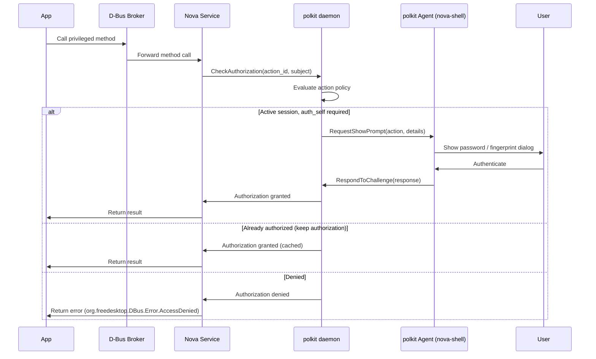

# NOVA OS — Security Architecture

> Version: 0.1-dev | Last updated: 2026-11-24  
> References: THREAT_MODEL.md, ARCHITECTURE.md

## Table of Contents

1. [Security Principles](#1-security-principles)
2. [Secure Boot Chain](#2-secure-boot-chain)
3. [SELinux Policy Design](#3-selinux-policy-design)
4. [Seccomp Profiles](#4-seccomp-profiles)
5. [Namespace Isolation](#5-namespace-isolation)
6. [polkit Authorization Flows](#6-polkit-authorization-flows)
7. [Cryptographic Standards](#7-cryptographic-standards)
8. [Audit Logging Architecture](#8-audit-logging-architecture)
9. [Incident Response](#9-incident-response)
10. [Security Hardening Checklist](#10-security-hardening-checklist)

---

## 1. Security Principles

NOVA OS implements security in depth across every layer of the stack:

1. **Defense in depth** — No single security control is sufficient; multiple independent layers protect each asset
2. **Fail closed** — When a security decision cannot be made, the default is denial
3. **Explicit allowlists** — Capabilities, syscalls, and D-Bus interfaces are denied by default and explicitly granted
4. **Auditability** — Every security-relevant event is logged with sufficient context for forensic reconstruction
5. **Minimal attack surface** — NOVA OS ships the minimum set of packages required; unused daemons and services are removed
6. **Cryptographic integrity** — All software components are cryptographically verified before execution

---

## 2. Secure Boot Chain

### 2.1 Chain of Trust

```
UEFI Firmware (OEM root of trust)
  │
  ▼ verifies signature
shim (signed by Microsoft for UEFI Secure Boot DB)
  │
  ▼ verifies signature (Fedora CA + NOVA CA)
GRUB2 (signed)
  │
  ▼ verifies signature
Linux Kernel (signed, bzImage)
  │
  ├─▶ Verifies initramfs (dracut HMAC)
  │
  ▼
initramfs (dracut)
  │
  ├─▶ Unlocks LUKS2 (via TPM PCR sealing or passphrase)
  ├─▶ Mounts dm-verity protected /usr
  │     hash tree verified against signed root hash
  └─▶ Pivots to real root (OSTree deployment)
```

### 2.2 UEFI Secure Boot

- NOVA OS ships a **custom UEFI Secure Boot certificate** (`nova-uefi-ca.cer`)
- Machines enrolled with NOVA should add this certificate to the UEFI Secure Boot DB (Allowed Signatures Database)
- The certificate is an X.509 RSA-4096 certificate valid for 5 years, stored offline in a HSM
- All bootloader stages (shim, GRUB, kernel) are signed with the corresponding private key

**Secure Boot Database contents required:**
```
DB:  Microsoft Windows Production CA 2011 (for shim)
     NOVA OS UEFI CA v1 (for GRUB, kernel)
DBX: (Fedora + NOVA OS revocation list)
```

### 2.3 Kernel Integrity

The kernel is compiled with:
```
CONFIG_INTEGRITY=y
CONFIG_IMA=y                        # Integrity Measurement Architecture
CONFIG_IMA_APPRAISE=y               # Enforce IMA signatures
CONFIG_IMA_DEFAULT_HASH="sha256"
CONFIG_EVM=y                        # Extended Verification Module
CONFIG_SECURITY_LOCKDOWN_LSM=y      # Lockdown mode (integrity level)
CONFIG_MODULE_SIG=y                 # Module signature verification
CONFIG_MODULE_SIG_FORCE=y           # Reject unsigned modules
CONFIG_RANDOMIZE_BASE=y             # KASLR
CONFIG_STACKPROTECTOR_STRONG=y      # Stack canaries
CONFIG_FORTIFY_SOURCE=y             # String function hardening
CONFIG_CFI_CLANG=y                  # Control Flow Integrity (future)
```

### 2.4 dm-verity

The `/usr` partition is protected by **dm-verity**:
- Hash tree stored in a separate dm-verity superblock
- Root hash is embedded in the signed initramfs
- Any bit-level modification to `/usr` causes the kernel to report I/O errors
- `/etc` and `/var` are writable (OSTree layout); sensitive config in `/etc` is covered by IMA appraisal

```bash
# dm-verity setup (performed during OS image build)
veritysetup format /dev/sda2 /dev/sda3  # data device, hash device
# Root hash embedded in initramfs:
ROOTFS_HASH="$(veritysetup format ... | grep 'Root hash:' | awk '{print $3}')"
```

### 2.5 TPM PCR Sealing (v0.2+)

For v0.2, the LUKS2 disk encryption key will be sealed to TPM 2.0 PCR values:

| PCR | Measured Data | Purpose |
|-----|--------------|---------|
| 0 | UEFI firmware | Detect firmware change |
| 2 | UEFI option ROMs | Detect rogue expansion ROM |
| 4 | Boot manager (GRUB) | Detect GRUB tampering |
| 7 | Secure Boot state | Detect Secure Boot disable |
| 11 | Kernel + initramfs | Detect kernel tampering |
| 14 | GRUB configuration | Detect bootloader config change |

The sealing policy requires PCR 0+2+4+7+11 to match; any change prevents auto-unlock and falls back to passphrase entry.

---

## 3. SELinux Policy Design

### 3.1 Policy Architecture

NOVA OS uses a **modular SELinux policy** built on top of Fedora's reference policy. Custom modules are compiled separately and loaded at boot.

```
os/policies/selinux/
├── nova.te              # Shared types and rules
├── nova_core.te         # nova-core service types and rules
├── nova_ai.te           # nova-ai-runtime and tool execution
├── nova_desktop.te      # nova-shell, GTK4 apps
├── nova_app.te          # Flatpak sandbox domain
├── nova_updater.te      # nova-updater
├── nova_audit.te        # nova-audit
├── nova.fc              # File contexts (/usr/lib/nova/*, /var/lib/nova/*, etc.)
├── nova.if              # Public interface macros
└── Makefile             # Builds all modules into nova.pp
```

### 3.2 Domain Definitions

```
# Primary domains
type nova_core_t;           # Core system service
type nova_ai_runtime_t;     # AI inference process
type nova_ai_tool_t;        # Individual sandboxed tool call
type nova_compositor_t;     # Wayland compositor (nova-shell)
type nova_app_t;            # Flatpak user application
type nova_updater_t;        # Update manager
type nova_audit_t;          # Audit log daemon

# File types
type nova_config_t;         # /etc/nova/
type nova_data_t;           # /var/lib/nova/
type nova_ai_model_t;       # /var/lib/nova/models/
type nova_ai_context_t;     # /var/lib/nova/sessions/ (encrypted)
type nova_log_t;            # /var/log/nova/
type nova_audit_log_t;      # /var/log/audit/audit.log (nova portion)
type nova_tmp_t;            # /tmp/nova-*/

# Binary types
type nova_exec_t;           # /usr/lib/nova/*/nova-*
type nova_ai_tool_exec_t;   # Tool binaries in sandbox
```

### 3.3 Key Policy Rules

```
# nova-ai-runtime: can read models, write sessions, cannot access user home
allow nova_ai_runtime_t nova_ai_model_t:file { read getattr open };
allow nova_ai_runtime_t nova_ai_context_t:file { read write create unlink };
deny nova_ai_runtime_t user_home_t:file { read write };   # explicit; also default

# nova-ai-tool: even more restricted — only its bind-mounted paths
allow nova_ai_tool_t nova_tmp_t:file { read write create unlink };
# No network unless explicitly labeled allow_network in tool policy
deny nova_ai_tool_t { port_t netif_t }:{ tcp_socket udp_socket } { bind connect };

# nova-compositor: access to DRM devices
allow nova_compositor_t drm_device_t:chr_file { read write ioctl };
allow nova_compositor_t input_device_t:chr_file { read ioctl };

# nova-updater: network access to update server only (port 443)
allow nova_updater_t nova_update_server_t:tcp_socket { connect };
# Cannot write to /usr (read-only mount; OSTree handles this)
deny nova_updater_t usr_t:dir { write add_name };

# nova-app (Flatpak): cannot access system bus for NOVA services
deny nova_app_t nova_core_t:dbus { send_msg };
deny nova_app_t nova_security_t:dbus { send_msg };

# nova-audit: append-only to its log file
allow nova_audit_t nova_audit_log_t:file { write append open };
deny nova_audit_t nova_audit_log_t:file { unlink rename };
```

### 3.4 SELinux Boolean Controls

NOVA OS defines custom SELinux booleans for user-adjustable policies:

| Boolean | Default | Description |
|---------|---------|-------------|
| `nova_ai_cloud_enabled` | off | Allow nova-ai-runtime to make outbound TLS connections |
| `nova_ai_tool_network` | off | Allow individual tools to access network |
| `nova_app_home_access` | off | Allow Flatpak apps to access home directory via portal |
| `nova_xwayland_enabled` | on | Allow XWayland server to run |
| `nova_developer_mode` | off | Allow loading unsigned kernel modules (for development) |

### 3.5 Policy Compilation and Loading

```bash
# Build the NOVA policy module
cd os/policies/selinux
make -f /usr/share/selinux/devel/Makefile nova.pp

# Install
semodule -i nova.pp

# Check for denials
audit2allow -a -M nova_local < /var/log/audit/audit.log

# Verify no unconfined domains
seinfo -aunconfined_t --roles  # should return 0 results for user apps
```

---

## 4. Seccomp Profiles

### 4.1 Profile Strategy

NOVA OS applies three seccomp profiles:

| Profile | Applied to | Approach |
|---------|-----------|---------|
| `nova-service.json` | System daemons (nova-core, etc.) | Allowlist of ~120 syscalls for Rust async services |
| `nova-compositor.json` | nova-shell | Allowlist including DRM ioctls, socket ops |
| `nova-tool-*.json` | AI tool sandbox | Per-tool allowlist of 30–60 syscalls |

### 4.2 Service Profile (nova-service.json)

```json
{
  "defaultAction": "SCMP_ACT_ERRNO",
  "archMap": [{"architecture": "SCMP_ARCH_X86_64", "subArchitectures": []}],
  "syscalls": [
    {"names": ["read", "write", "readv", "writev", "pread64", "pwrite64"], "action": "SCMP_ACT_ALLOW"},
    {"names": ["open", "openat", "openat2", "close", "stat", "fstat", "lstat", "newfstatat"], "action": "SCMP_ACT_ALLOW"},
    {"names": ["mmap", "mprotect", "munmap", "brk", "madvise", "mremap"], "action": "SCMP_ACT_ALLOW"},
    {"names": ["socket", "connect", "bind", "listen", "accept", "accept4", "sendto", "recvfrom", "sendmsg", "recvmsg"], "action": "SCMP_ACT_ALLOW"},
    {"names": ["epoll_create1", "epoll_ctl", "epoll_wait", "epoll_pwait", "eventfd2", "timerfd_create", "timerfd_settime", "timerfd_gettime"], "action": "SCMP_ACT_ALLOW"},
    {"names": ["getpid", "getppid", "getuid", "getgid", "geteuid", "getegid", "getgroups"], "action": "SCMP_ACT_ALLOW"},
    {"names": ["futex", "set_robust_list", "get_robust_list"], "action": "SCMP_ACT_ALLOW"},
    {"names": ["clone", "clone3", "fork", "vfork"], "action": "SCMP_ACT_ALLOW"},
    {"names": ["execve", "execveat"], "action": "SCMP_ACT_ALLOW"},
    {"names": ["wait4", "waitid"], "action": "SCMP_ACT_ALLOW"},
    {"names": ["exit", "exit_group"], "action": "SCMP_ACT_ALLOW"},
    {"names": ["rt_sigaction", "rt_sigprocmask", "rt_sigreturn", "sigaltstack"], "action": "SCMP_ACT_ALLOW"},
    {"names": ["ioctl"], "action": "SCMP_ACT_ALLOW", "args": [{"index": 1, "value": 21505, "op": "SCMP_CMP_EQ"}]},
    {"names": ["prctl"], "action": "SCMP_ACT_ALLOW", "args": [{"index": 0, "value": 15, "op": "SCMP_CMP_EQ"}]},
    {"names": ["getrandom", "clock_gettime", "clock_nanosleep", "nanosleep"], "action": "SCMP_ACT_ALLOW"},
    {"names": ["pipe2", "dup", "dup2", "dup3", "fcntl", "lseek"], "action": "SCMP_ACT_ALLOW"},
    {"names": ["mkdir", "mkdirat", "rmdir", "unlink", "unlinkat", "rename", "renameat2"], "action": "SCMP_ACT_ALLOW"},
    {"names": ["sched_yield", "sched_getaffinity", "sched_setaffinity"], "action": "SCMP_ACT_ALLOW"},
    {"names": ["sendfile"], "action": "SCMP_ACT_ALLOW"},
    {"names": ["umask", "umask2"], "action": "SCMP_ACT_ALLOW"}
  ],
  "blocked": [
    "ptrace", "process_vm_readv", "process_vm_writev",
    "keyctl", "add_key", "request_key",
    "perf_event_open", "bpf",
    "mount", "umount2", "pivot_root",
    "init_module", "finit_module", "delete_module",
    "kexec_load", "kexec_file_load",
    "setuid", "setgid", "setresuid", "setresgid", "capset"
  ]
}
```

### 4.3 AI Tool Profile (nova-tool-filesystem.json)

For the `file_read`/`file_write` tool type:

```json
{
  "defaultAction": "SCMP_ACT_ERRNO",
  "syscalls": [
    {"names": ["read", "write", "open", "openat", "close", "stat", "fstat", "lstat"], "action": "SCMP_ACT_ALLOW"},
    {"names": ["mmap", "mprotect", "munmap", "brk"], "action": "SCMP_ACT_ALLOW"},
    {"names": ["getdents64", "readlink", "readlinkat"], "action": "SCMP_ACT_ALLOW"},
    {"names": ["getpid", "getuid", "geteuid", "exit", "exit_group"], "action": "SCMP_ACT_ALLOW"},
    {"names": ["rt_sigaction", "rt_sigreturn", "sigaltstack"], "action": "SCMP_ACT_ALLOW"},
    {"names": ["futex", "set_robust_list"], "action": "SCMP_ACT_ALLOW"},
    {"names": ["getrandom", "clock_gettime"], "action": "SCMP_ACT_ALLOW"},
    {"names": ["write", "pwrite64"], "action": "SCMP_ACT_ALLOW"}
  ]
}
```

**Explicitly blocked in all tool profiles:**
- `socket`, `connect`, `bind` (no network)
- `ptrace`, `process_vm_readv` (no process inspection)
- `keyctl`, `add_key` (no keyring access)
- `mount`, `pivot_root` (no namespace escape)
- `setuid`, `capset` (no privilege acquisition)
- `bpf`, `perf_event_open` (no kernel introspection)

---

## 5. Namespace Isolation

### 5.1 AI Tool Sandbox Namespace Stack

Each AI tool call creates a new set of Linux namespaces via bubblewrap:

```bash
bwrap \
  --ro-bind /usr /usr \                    # Read-only /usr
  --ro-bind /lib /lib \                    # Read-only libraries
  --ro-bind /lib64 /lib64 \
  --bind /tmp/nova-tool-$SESSION_ID /tmp \ # Writable scratch space
  --ro-bind /allowed/input/path /input \   # Explicitly granted read path
  --bind /allowed/output/path /output \    # Explicitly granted write path
  --dev /dev \                             # Minimal /dev
  --proc /proc \                           # Proc for the new PID namespace
  --unshare-all \                          # New mount, PID, UTS, IPC, net namespaces
  --new-session \                          # New session (no terminal control)
  --die-with-parent \                      # Kill sandbox if parent dies
  --seccomp 9 \                            # Apply seccomp filter (fd 9)
  --setenv HOME /tmp \
  --setenv PATH /usr/bin \
  -- /usr/lib/nova/tools/$TOOL_NAME "$@"
```

### 5.2 Namespace Types Used

| Namespace | Purpose |
|-----------|---------|
| **Mount** | Sandboxed filesystem view; only explicitly bind-mounted paths visible |
| **PID** | Sandbox has its own PID 1; cannot see host processes |
| **Network** | No network interface (only loopback, which is also blocked by seccomp) |
| **UTS** | Custom hostname (`nova-tool-sandbox`) |
| **IPC** | Isolated System V IPC; no shared memory with host |
| **User** | (not used by default; bubblewrap uses setuid) |

### 5.3 Flatpak Namespace Configuration

Flatpak applications run in a bubblewrap sandbox with:
- Shared mount namespace for host `/run/user/UID/` (for portals, Wayland socket)
- Private `/home` (only the XDG directories granted by portal)
- Private `/tmp`
- Shared `/proc`, `/dev` (read-only)
- Network namespace: shared by default (apps can access internet); portal required for new connections in future

---

## 6. polkit Authorization Flows

### 6.1 Standard Authorization Flow



### 6.2 polkit Action Catalog

| Action ID | Allow Active | Allow Inactive | Requires Admin |
|-----------|-------------|----------------|----------------|
| `org.nova.core.reboot` | yes | auth_admin | No |
| `org.nova.core.poweroff` | yes | auth_admin | No |
| `org.nova.core.modify-system` | auth_admin_keep | no | Yes |
| `org.nova.security.set-selinux-mode` | auth_admin_keep | no | Yes |
| `org.nova.security.load-policy` | auth_admin | no | Yes |
| `org.nova.updater.apply-update` | auth_admin | no | Yes |
| `org.nova.updater.set-channel` | auth_admin | no | Yes |
| `org.nova.ai.execute-tool` | auth_self | no | No |
| `org.nova.ai.enable-cloud` | auth_self | no | No |
| `org.nova.shell.take-screenshot` | yes | no | No |
| `org.nova.shell.lock-screen` | yes | yes | No |

### 6.3 polkit JavaScript Rules

```javascript
// /usr/share/polkit-1/rules.d/10-nova.rules

polkit.addRule(function(action, subject) {
    // Block all nova system actions for non-wheel users
    if (action.id.startsWith("org.nova.core.modify") ||
        action.id.startsWith("org.nova.security.")) {
        if (!subject.isInGroup("wheel")) {
            return polkit.Result.NO;
        }
    }

    // AI tool execution: require active session only
    if (action.id === "org.nova.ai.execute-tool") {
        if (subject.active) {
            return polkit.Result.AUTH_SELF;
        }
        return polkit.Result.NO;
    }

    // Reboot/shutdown: active users always, inactive need admin
    if (action.id === "org.nova.core.reboot" ||
        action.id === "org.nova.core.poweroff") {
        if (subject.active) {
            return polkit.Result.YES;
        }
        return polkit.Result.AUTH_ADMIN;
    }
});
```

---

## 7. Cryptographic Standards

### 7.1 Algorithms

| Use case | Algorithm | Key size | Implementation |
|---------|-----------|---------|----------------|
| OS image signing | ECDSA P-384 | 384-bit | cosign (Sigstore) |
| TLS (AI cloud, updates) | TLS 1.3 | — | rustls (default cipher: AES-256-GCM-SHA384) |
| Disk encryption | AES-XTS | 256-bit | LUKS2 (kernel crypto API) |
| AI context storage | AES-256-GCM | 256-bit | `aes-gcm` Rust crate |
| Key derivation (LUKS) | Argon2id | — | `argon2` Rust crate |
| Secure Boot | RSA + SHA-256 | 4096-bit | UEFI signing standard |
| Package signing (rpm) | RSA + SHA-256 | 4096-bit | GPG (Fedora standard) |
| AI provider API auth | ECDSA P-256 (OAuth JWT) | — | Per-provider SDK |
| Update manifest signing | ECDSA P-384 | 384-bit | cosign |
| Certificate pinning | SHA-256 of SPKI | — | `rustls-native-certs` + custom pinner |

### 7.2 Prohibited Algorithms

The following algorithms are explicitly prohibited in NOVA OS:

- MD5, SHA-1 (hash only, legacy compatibility excepted for GPG verification of old packages)
- RSA < 3072-bit for new key generation
- DES, 3DES, RC4, RC2, Blowfish (symmetric)
- TLS < 1.2 (all services use TLS 1.3; fallback to TLS 1.2 only for legacy repository compatibility)
- PKCS#1 v1.5 RSA signing (only PSS or OAEP permitted)
- Hardcoded cryptographic keys (compile-time audit enforced by `cargo-deny`)

### 7.3 Key Management

```
Signing keys:
  nova-uefi-ca.key     → Offline HSM (YubiHSM2), ceremony required for use
  nova-os-sign.key     → CI HSM (Nitrokey HSM), automated signing in pipeline
  nova-pkg-sign.key    → CI HSM, automated package signing

Runtime keys:
  LUKS volume key      → Sealed to TPM PCRs (v0.2+) or derived from passphrase
  ContextStore key     → Derived per-session via Argon2id from user credential
                         Stored in kernel keyring (KEY_TYPE_LOGON)
  AI provider API key  → Stored in GNOME keyring (libsecret) or user TPM-sealed blob
```

---

## 8. Audit Logging Architecture

### 8.1 Event Sources

```
┌─────────────────────────────────────────────────────┐
│                   Audit Sources                      │
├──────────────┬──────────────┬────────────────────────┤
│ Linux kernel │ nova-audit   │ Application events     │
│ audit system │ D-Bus event  │ (structured JSON logs) │
│              │ collector    │                        │
└──────┬───────┴──────┬───────┴────────────┬───────────┘
       │              │                    │
       ▼              ▼                    ▼
   auditd         nova-audit          journald
   (kernel        (subscribes to      (structured
   syscall        D-Bus signals)      syslog)
   events)             │
       │               │
       └───────┬────────┘
               ▼
          /var/log/audit/
          nova-audit.log
          (append-only,
           SELinux protected)
               │
               ▼ (future v0.2)
          Remote syslog / SIEM
          (TLS, mutual auth)
```

### 8.2 Logged Events

| Category | Events Logged | Retention |
|---------|--------------|-----------|
| **Boot** | Secure Boot state, dm-verity status, SELinux mode | Forever |
| **Auth** | polkit decisions (grant/deny), PAM events | 90 days |
| **AI** | Session create/destroy, tool calls (approved/denied), model loads | 30 days (configurable) |
| **Files** | Access to sensitive paths (SELinux audit) | 30 days |
| **Network** | Outbound connections from AI runtime, update server contacts | 30 days |
| **System** | Service start/stop/fail, SELinux denials | 90 days |
| **Updates** | Update checks, downloads, applications, rollbacks | Forever |
| **Security** | SELinux mode changes, policy loads, kernel module loads | Forever |

### 8.3 Log Format

All nova-audit structured events use JSON:

```json
{
  "schema": "nova.audit.v1",
  "seq": 100042,
  "ts": "2026-11-24T10:30:15.123456Z",
  "event": "ai.tool.execute",
  "severity": "info",
  "session_id": "a3f4b5c6-...",
  "user_uid": 1000,
  "tool": "file_read",
  "args": {"path": "/home/user/documents/report.pdf"},
  "approved_by": "user_consent_dialog",
  "result": "success",
  "duration_ms": 234,
  "selinux_context": "system_u:system_r:nova_ai_tool_t:s0"
}
```

### 8.4 Log Integrity

- Audit log file: `nova_audit_log_t` SELinux type; only `nova_audit_t` domain can append
- Log rotation: 50 MB max per file; 20 rotations kept; rotated files are gzip-compressed and checksummed
- Future v0.2: Remote syslog with HMAC integrity verification; logs shipped to operator-controlled SIEM within 30 seconds

### 8.5 nova-audit Crate API

```rust
// crates/nova-audit/src/lib.rs

pub struct AuditLogger {
    fd: OwnedFd,         // Audit netlink socket
    dbus: Connection,    // D-Bus connection for event subscription
}

pub enum AuditEventKind {
    Boot { secure_boot: bool, dm_verity: bool, selinux_mode: SelinuxMode },
    Auth { action: String, subject_uid: u32, result: AuthResult },
    AiToolCall { session_id: Uuid, tool: String, args: serde_json::Value, result: ToolResult },
    SelinuxDenial { scontext: String, tcontext: String, class: String, permission: String },
    UpdateApplied { from_version: String, to_version: String, channel: String },
    ServiceStateChange { unit: String, old_state: String, new_state: String },
}

impl AuditLogger {
    pub async fn log(&self, event: AuditEventKind) -> Result<u64>;
    pub async fn query(&self, filter: AuditFilter) -> Result<Vec<AuditRecord>>;
    pub async fn subscribe_denials(&self) -> impl Stream<Item = SelinuxDenial>;
}
```

---

## 9. Incident Response

### 9.1 Severity Levels

| Level | Definition | Response Time | Example |
|-------|-----------|---------------|---------|
| **P0 Critical** | Active exploit, data breach, or complete system compromise | 2 hours | Remote code execution in nova-core |
| **P1 High** | Vulnerability with working PoC, Flatpak sandbox escape | 24 hours | SELinux policy gap allowing domain escalation |
| **P2 Medium** | Vulnerability without PoC; significant privacy impact | 7 days | Information disclosure in AI runtime |
| **P3 Low** | Hardening improvement; theoretical vulnerability | 30 days | Weak seccomp profile; minor config issue |

### 9.2 Response Procedure

**Step 1: Detection**
- Automated: SELinux denial spike, `nova-audit` anomaly detection, `cargo-audit` advisory match
- Manual: User report, researcher disclosure, upstream CVE notification

**Step 2: Triage (within 1 hour of P0, 4 hours of P1)**
- Assign severity level
- Identify affected components and versions
- Determine if active exploitation is occurring
- Create private security tracking issue

**Step 3: Containment (P0/P1)**
- If active exploitation: advise users to boot into previous OSTree deployment (rollback)
- If network-based: publish temporary firewall rules
- If AI-related: advise disabling cloud AI until patched

**Step 4: Root Cause Analysis**
- Reproduce the vulnerability in a test environment
- Identify the vulnerable code path
- Review related code for similar issues

**Step 5: Remediation**
- Develop and test the fix in a private branch
- For P0/P1: expedited review by ≥2 security team members
- Build patched OS image in CI with reproduced test case

**Step 6: Disclosure**
- Coordinate with upstream if applicable (Fedora, crate maintainers)
- Publish security advisory with CVE (request via MITRE if applicable)
- Release patched OS image to stable channel
- Update THREAT_MODEL.md with new risk entry

**Step 7: Post-Incident Review**
- Within 7 days of resolution: write post-mortem
- Identify systemic improvements
- Update security controls and test coverage

### 9.3 Reporting Security Issues

Security issues should be reported to: **security@nova-os.example** (GPG encrypted, key fingerprint in SECURITY-CONTACTS file)

Do NOT report security issues in public GitHub issues. We follow a 90-day responsible disclosure policy.

---

## 10. Security Hardening Checklist

Applied at every NOVA OS image build:

```
Kernel:
  [x] KASLR enabled (CONFIG_RANDOMIZE_BASE)
  [x] Stack protector strong (CONFIG_STACKPROTECTOR_STRONG)
  [x] FORTIFY_SOURCE=2
  [x] Module signature enforcement
  [x] Lockdown integrity mode
  [x] IMA appraisal enabled
  [x] No unprivileged user namespaces (sysctl kernel.unprivileged_userns_clone=0)
  [x] Restrict /proc/kallsyms (kernel.kptr_restrict=2)
  [x] Restrict dmesg (kernel.dmesg_restrict=1)
  [x] No kernel pointer leaks (kernel.perf_event_paranoid=3)

Network:
  [x] IPv4/IPv6 source routing disabled
  [x] ICMP redirects disabled
  [x] TCP SYN cookies enabled
  [x] Reverse path filtering enabled
  [x] No IP forwarding (kernel.ip_forward=0)

Filesystem:
  [x] /usr mounted read-only (OSTree)
  [x] dm-verity on /usr
  [x] /tmp on tmpfs (cleared on reboot)
  [x] /proc/sysrq-trigger disabled (kernel.sysrq=0)
  [x] Restrict ptrace (kernel.yama.ptrace_scope=1)

SELinux:
  [x] SELinux=enforcing in kernel cmdline
  [x] No unconfined domains
  [x] Policy compiled with -Werror (no policy warnings in production)

Services:
  [x] No telnet, ftp, rsh, rlogin
  [x] SSH disabled by default; opt-in for developers
  [x] No NFS server
  [x] Avahi/mDNS disabled (zero-conf not needed)
  [x] Minimal cron jobs (only system update check)
  [x] No world-writable directories outside /tmp
  [x] setuid binary inventory (tracked in os/policies/setuid-inventory.txt)
```
